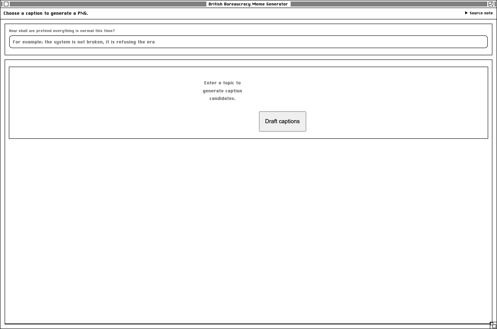
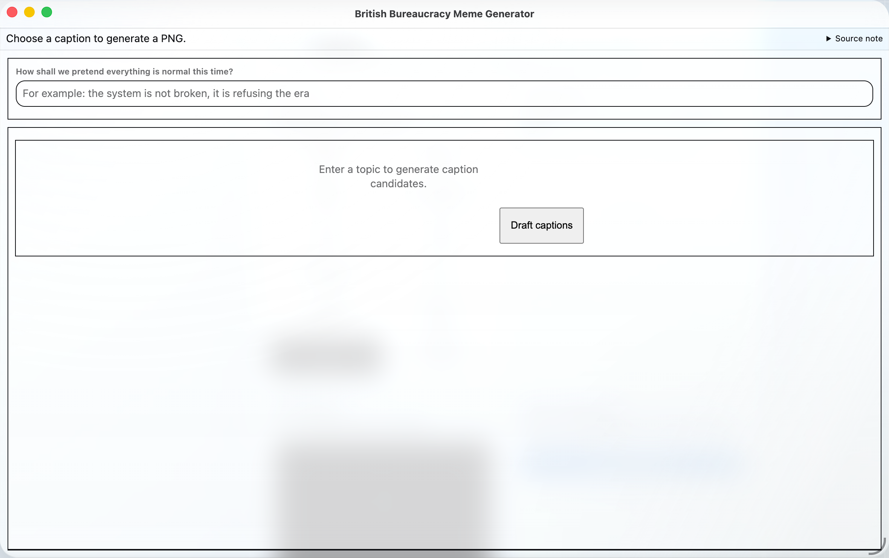

# 官僚梗图（Bureaucracy Meme）

一个在浏览器里运行的工具：为原创模板或本机上传的图片拟双语英式官僚梗图字幕，
再导出 PNG；也可由宿主页面嵌进窗口。

## 截图

在 AI System 6 桌面里实际运行时截取，左为 Classic，右为 Liquid Glass。

<p> </p>

## 运行页面

```bash
npm start
```

然后打开 `http://localhost:8080/`。

拟字幕需要宿主桌面提供 `bureaucracyMeme.captions` 服务（由桌面用控制面板里的
模型设置建路由）。单独打开本页时，该服务不可用，工具会显示与「没有可用模型」
时相同的提示。

## 宿主需要什么

| 需要 | 说明 |
| --- | --- |
| Bridge | 协议 1（`ais6-bridge.js`）；能力 `services`、`files`、`appearance`、`snapshot` |
| 服务 | `bureaucracyMeme.captions`，参数 `{ topic, tone, templateId, mood, imageDataUrl }` → `{ captions, provider, model }` 或 `{ ok: false, reason }` |
| 文件 | `files.export` 用于导出 PNG |
| 模板（可选） | 同源 `GET /data/bureaucracy-templates.json`；没有则用内置三张原创模板 |
| 图片（可选） | 当 JSON 指向 `/assets/bureaucracy/*.svg` 时需同源提供；本仓库在 `assets/` 也带了副本 |

## 构建

```bash
npm run build
```

把宿主要嵌入的文件复制到 `dist/`（与应用树一一对应）。没有依赖，有 Node 就行。

## 目录

| 路径 | 内容 |
| --- | --- |
| `index.html`、`main.js`、`bureaucracy-meme.js`、`bureaucracy-meme.css` | 页面、功能模块与样式 |
| `strings-en.js`、`strings-zh.js` | 中英文字符串表 |
| `shared/` | 基础样式，以及对接 bridge 的运行时 |
| `assets/` | 三张原创虚构模板 SVG |
| `ais6-bridge.js`、`kit.css`、`app.manifest.json` | 让宿主页面把工具嵌进框架、导出 PNG 并画出菜单；单独打开时，同样的调用退回本机下载与本机外观 |
| `tools/build.mjs` | 把嵌入用的文件复制到 `dist/` |

## 许可

MIT。见 [LICENSE](LICENSE)。素材许可见 [LICENSES.md](LICENSES.md)。

English: [README.md](README.md).
